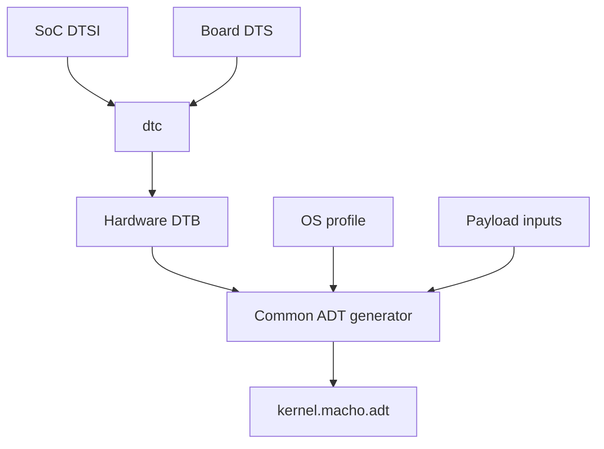

# Device tree

Format 2 compiles a hardware tree and generates the Apple device tree centrally.



Firmware and bootloader interfaces use FDT. XNU receives the ADT sidecar next
to `kernel.macho`. DarwinBoot reads it from the payload entry directory.

## Procedure {#procedure}

1. Gather the board DTS, selected SoC DTSI and the properties consumed by the drivers. Set the source and include paths in [Configuration](#configuration).
2. Describe hardware with the [bindings](#hardware-bindings): parent cell widths, ranges, interrupts, references and enabled nodes. Check the [required XNU nodes](#required-nodes).
3. Place Apple platform properties in the selected [OS profile](#os-properties), with board overrides where required. Match the root UUID and payload handoff options to the actual inputs.
4. Run [standalone conversion](#standalone-conversion) to compile a DTB and generate an ADT with the selected inputs. Review compiler diagnostics and generated node names against the driver matching requirements.
5. Run `./unixnu payload` and `./unixnu bootimg` using the saved build inputs. Inspect `device-tree/hardware.dtb` and the payload report under the resolved output directory. The [firmware DTB](#boot-image-device-tree) is a separate boot-image input.

## Configuration

```toml
[device_tree]
source = "device:dts/sheng.dts"
include_dirs = ["soc:dts"]
```

The payload step runs `dtc` and writes `device-tree/hardware.dtb` under the
resolved output directory. `scripts/unixnu/devicetree.py` reads FDT, converts
hardware properties, adds the OS and payload properties, and encodes ADT.

The board DTS includes its SoC DTSI:

```text
/dts-v1/;
/include/ "sm8550.dtsi"

/ {
    model = "Xiaomi Pad 6S Pro";
    compatible = "xiaomi,sheng", "qcom,sm8550";
};
```

The complete board source supplies memory, enabled CPUs, and peripheral inputs.
See the [device template](/porting/device-repository) and [SoC support](/porting/soc-support).

## Hardware bindings

| Property | Input | ADT representation |
| --- | --- | --- |
| `compatible`, `device_type`, `reg-names`, `interrupt-names`, `clock-names`, `method` | NUL-terminated strings | String bytes |
| `phandle`, `linux,phandle`, `#interrupt-cells`, `#iommu-cells`, `clock-frequency`, `timebase-frequency` | One big-endian cell | Little-endian u32 |
| `redistributor-stride` | One or two cells | Little-endian u64 |
| `interrupt-controller`, `dma-coherent` | Empty property | Empty property |
| `reg` | Address/size tuples using the parent's cell widths | Translated physical u64 address/size pairs |
| `interrupts` | Specifiers using the referenced controller's `#interrupt-cells` | Little-endian cells |
| `interrupt-parent` | Controller phandle | Little-endian phandle |
| `iommus`, `clocks` | Phandle and provider-defined argument cells | Little-endian cells |
| `unixnu,adt-name` | Exported hardware node name | Child name under `/arm-io` |
| `status` | `okay`, `ok`, or disabled state | Selects enabled nodes |

Every translated bus declares `ranges`. An empty `ranges` gives an identity
mapping. Each register range must have one matching translation. Referenced
providers require unique nonzero phandles and their argument-cell counts.
Interrupt specifiers must match the selected interrupt controller.

The generator exports enabled nodes with `unixnu,adt-name`. Exported names are
unique. Add a typed binding in the common converter when a driver needs another
property. FDT integer cells are decoded before ADT encoding.

The root supplies `model` and `compatible`. One enabled memory node provides a
contiguous DRAM range. `/cpus` supplies `timebase-frequency`; each enabled CPU
has `reg` containing its MPIDR affinity and `compatible`. The first enabled CPU
is the boot CPU. Multiple CPUs require `/psci` with `method = "smc"` or `"hvc"`.

## OS properties

The OS profile declares typed tables under `[adt]`, such as:

```toml
[adt.chosen.string]
osenvironment = "main"

[adt.defaults.u32]
sleep-disabled = 1
```

Supported property types are `string`, `strings`, `u32`, `u64`, and hex `bytes`.
The tables populate `root`, `chosen`, `defaults`, `options`, `product`, and
`buttons`. The common generator creates CHRP NVRAM, a fresh 64-byte random seed,
platform identity, root matching, and payload memory-map placeholders.

## Standalone conversion

```sh
dtc -I dts -O dtb -i ../UniXNU-sm8550-common/dts   -o /tmp/sheng.dtb ../UniXNU-sheng/dts/sheng.dts
python3 scripts/make-adt.py --dtb /tmp/sheng.dtb   --os-profile profiles/os/ipados-17.7.11-21H461/profile.toml   --board ../UniXNU-sheng/board.toml --unique-chip-id <hex>   --data-ramdisk --trust-cache --output /tmp/kernel.macho.adt
```

The command selects memory-map placeholders for the supplied payload inputs.
`unixnu build payload` uses the fully resolved profiles and its actual inputs.

## Apple device tree encoding

An Apple device tree uses a compact node encoding:

```
u32 property_count
u32 child_count
for each property:
  char name[32]
  u32 length
  u8  value[length]
  padding to 4 bytes
for each child:
  node
```

Every node carries a `name` property with its own name and a terminating NUL.

The common encoder writes little-endian ADT fields and four-byte property padding.

## Required nodes

The generic `ArmDTPlatform` requires these top level nodes:

| Node | Required contents |
| --- | --- |
| `/chosen` | `random-seed`, CHRP NVRAM proxy, DRAM description, `osenvironment` |
| `/cpus` | One `cpuN` child per core |
| `/arm-io` | Bus node with `#address-cells`, `#size-cells`, `ranges` |
| `/defaults` | Platform defaults |
| `/options` | Platform options |

The platform expert fails `configure()` when one of these nodes is absent. It also fails when `/chosen` has no usable NVRAM proxy.

### NVRAM proxy

XNU publishes the real `IODTNVRAM` from `/chosen`. The proxy uses the CHRP bank format:

| Property | Contents |
| --- | --- |
| `nvram-bank-size` | Bank size, 32-bit |
| `nvram-bank-count` | Number of banks, 32-bit |
| `nvram-current-bank` | Current bank index, 32-bit |
| `nvram-proxy-data` | The bank image |

The bank image contains a `nvram` header, a `common` header with a two kilobyte data area, and a `free` header. The `common` data area has an Adler-32 checksum at offset 16.

An empty proxy is enough for a device with no persistent NVRAM controller.

### Chosen properties

| Property | Type | Purpose |
| --- | --- | --- |
| `random-seed` | 64 bytes | Kernel entropy seed |
| `unique-chip-id` | 64-bit | Seeds `IOPlatformUUID` with `chip-id` |
| `chip-id` | 32-bit | Platform identity seed |
| `osenvironment` | string | `main`, `recoveryos` or `ramdisk` |
| `dram-base` | 64-bit | Physical DRAM base |
| `dram-size` | 64-bit | Physical DRAM size |
| `crypto-hash-method` | string | Image4 hash method, for example `sha2-384` |
| `root-matching` | dictionary | Root volume match dictionary |
| `ephemeral-storage` | 32-bit | Marks the writable Data volume as ephemeral |
| `darwinboot-memory-size` | 64-bit | Contiguous window request, 256 MiB to 8 GiB in 2 MiB steps |
| `amfi-only-platform-code` | 32-bit | Keeps AMFI in its platform code policy |
| `boot-manifest-hash` | bytes | Boot manifest hash for the owner path |

`unique-chip-id` and `chip-id` seed `IOPlatformUUID`. Without them, callers that pass a zero timeout to `gethostuuid()` wait indefinitely.

### Memory map

`/chosen/memory-map` holds the placeholders DarwinBoot fills:

| Property | Length | Filled with |
| --- | --- | --- |
| `RAMDisk` | 16 bytes | Address and size of the dense Data image |
| `PackedRAMDisk` | 16 bytes | Address and size of the packed Data image |
| `TrustCache` | 16 bytes | Address and size of the trust cache |

A placeholder is required for every input. A missing placeholder makes DarwinBoot return `EFI_COMPROMISED_DATA`.

### CPUs

```c
cpu0 {
  name = "cpu0";
  state = "running";
  reg = <0>;
  device_type = "cpu";
  compatible = "arm,cortex-a715";
  timebase-frequency = <19200000>;
}
```

The first CPU is the boot CPU. Its `reg` value is the MPIDR affinity value. More than one CPU adds a `/psci` node with `compatible = "arm,psci-1.0"` and `method = "smc"` or `"hvc"`.

### arm-io

```c
arm-io {
  name = "arm-io";
  device_type = "arm-io";
  #address-cells = <2>;
  #size-cells = <2>;
  ranges = <0 0 0x100000000>;
  intc {
    name = "intc";
    compatible = "arm,gic-v3";
    reg = <...>;
  };
}
```

`ranges` maps the bus window. The common generator translates source registers to physical addresses, then emits `arm-io` with one window from the lowest exported register (rounded down to 16 MiB) to the highest. Child `reg` values are offsets from the window base. XNU reads that base as the SoC base and requires it to be non-zero, so an exported register below 16 MiB is an error.

### product and buttons

`/product` supplies the product name and model. `/buttons` supplies the button names and `home-button-type`. MobileGestalt and the platform code read these nodes. The full property set, gesture setup and device family switch are in [MobileGestalt identity](/guide/mobilegestalt).

### Platform defaults

`/defaults` supplies platform options. For example, `sleep-disabled = <1>` prevents the CPU from parking when suspend is not implemented.

## Format 1 ADT tool

Format 1 uses the device script selected by `[payload.adt] tool`. Its arguments
are listed in [Payload](/concepts/payload). The script supplies the required
nodes, CHRP NVRAM, random seed, identity, root matching, and memory-map placeholders.

## UEFI device tree

The firmware exposes its own FDT through `EFI_DTB_TABLE`. UniXNU can patch it and pass it to EFI or Linux entries.

An entry selects a tree:

```toml
[[entry]]
id = "linux"
type = "linux"
path = "Payloads/Image"
dtb = "DeviceTree/board.dtb"
```

`dtb = "firmware"` uses the firmware tree. A path uses a file on the payload volume. The tree is copied with 64 KiB of slack, global patches are applied, then entry patches, then `[entry.chosen]`.

Patches support `set`, `delete-prop`, `add-node`, `delete-node` and `overlay`:

```toml
[[dt_patch]]
op = "set"
node = "/chosen"
prop = "bootargs"
value = "console=ttyAMA0"

[[dt_patch]]
op = "overlay"
file = "DeviceTree/board.dtbo"
```

DarwinBoot reads the `.adt` sidecar. An `xnu` entry that sets `dtb` passes a tree in the loader request, and the shipped DarwinBoot refuses a request with a non-null device tree.

## Boot image device tree

The boot image carries a device tree after the gzip stream. The stock bootloader may require nodes that the firmware tree does not have.

```toml
[[bootimg.dtb_node]]
path = "/reserved-memory/splash_region"
props = [
  { name = "label", type = "s", value = "cont_splash_region" },
  { name = "reg", type = "x", value = ["0x0", "0xb8000000", "0x0", "0x2b00000"] },
]
```

`unixnu bootimg` applies these nodes with `fdtput` and verifies integer properties round-trip.

## Reference generators

| Generator | Purpose |
| --- | --- |
| `scripts/qemu-entry/make-dt.py` | QEMU fixture with a single CPU and optional GICv3, VirtIO and NVRAM |
| `scripts/make-adt.py` | Hardware DTB and OS/board profiles to ADT |
| Format 1 device `make-<device>-adt.py` | Device-specific generator |

The QEMU generator is the smallest complete example. The device page in [Devices](/devices/) records the values for a real board.

## Next steps

- [Payload](/concepts/payload)
- [Device tree matching](/drivers/device-tree-matching)
- [Bring-up order](/porting/bring-up)
