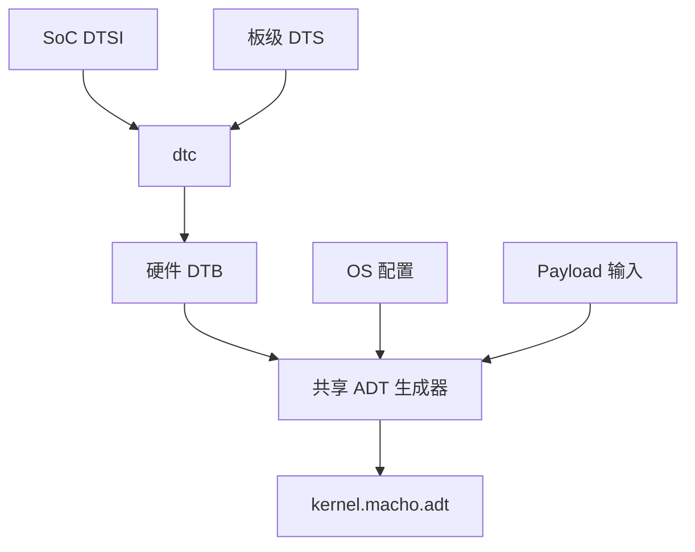

# 设备树

格式 2 编译硬件设备树，并由共享工具生成 Apple 设备树。



固件和 bootloader 接口使用 FDT。XNU 接收与 `kernel.macho` 放在一起的 ADT sidecar，
DarwinBoot 从启动项目录读取它。

## 操作步骤 {#procedure}

1. 准备板级 DTS、所选 SoC DTSI 和驱动读取的属性，按[配置](#配置)设置源文件与 include 路径。
2. 按[硬件绑定](#硬件绑定)描述父节点 cell 宽度、地址范围、中断、引用和启用节点，核对 [XNU 必需节点](#必需节点)。
3. 将 Apple 平台属性放在所选 [OS profile](#os-属性)，按需添加板级覆盖。根卷 UUID 和 payload 交接选项应匹配实际输入。
4. 执行[独立转换](#独立转换)，编译 DTB 并用所选输入生成 ADT。核对编译诊断、生成的节点名称与驱动匹配要求。
5. 使用保存的输入运行 `./unixnu payload` 和 `./unixnu bootimg`，检查解析输出目录中的 `device-tree/hardware.dtb` 和 payload 报告。[固件 DTB](#启动镜像设备树)单独作为启动镜像输入。

## 配置

```toml
[device_tree]
source = "device:dts/sheng.dts"
include_dirs = ["soc:dts"]
```

payload 步骤运行 `dtc`，在解析后的输出目录写入 `device-tree/hardware.dtb`。
`scripts/unixnu/devicetree.py` 读取 FDT、转换硬件属性、加入 OS 与 payload 属性，最后编码 ADT。

板级 DTS 包含 SoC DTSI：

```text
/dts-v1/;
/include/ "sm8550.dtsi"

/ {
    model = "Xiaomi Pad 6S Pro";
    compatible = "xiaomi,sheng", "qcom,sm8550";
};
```

完整板级源码提供内存、启用的 CPU 和外设输入。参见[设备模板](/zh/porting/device-repository)
和 [SoC 支持](/zh/porting/soc-support)。

## 硬件绑定

| 属性 | 输入 | ADT 表示 |
| --- | --- | --- |
| `compatible`, `device_type`, `reg-names`, `interrupt-names`, `clock-names`, `method` | NUL 结尾的字符串 | 字符串字节 |
| `phandle`, `linux,phandle`, `#interrupt-cells`, `#iommu-cells`, `clock-frequency`, `timebase-frequency` | 一个大端 cell | 小端 u32 |
| `redistributor-stride` | 一或两个 cell | 小端 u64 |
| `interrupt-controller`, `dma-coherent` | 空属性 | 空属性 |
| `reg` | 按父节点 cell 宽度编码的地址和长度 | 转换后的物理 u64 地址与长度对 |
| `interrupts` | 按控制器 `#interrupt-cells` 编码的描述符 | 小端 cell |
| `interrupt-parent` | 控制器 phandle | 小端 phandle |
| `iommus`, `clocks` | phandle 和提供者定义的参数 cell | 小端 cell |
| `unixnu,adt-name` | 导出的硬件节点名 | `/arm-io` 下的子节点名 |
| `status` | `okay`、`ok` 或禁用状态 | 选择启用节点 |

参与地址转换的总线声明 `ranges`，空 `ranges` 表示恒等映射。每个寄存器范围必须恰好
匹配一条转换。引用目标的 phandle 必须非零且唯一，参数数量由提供者声明。
中断描述符必须匹配选中的中断控制器。

生成器导出带 `unixnu,adt-name` 的启用节点，导出名必须唯一。驱动需要其他属性时，
在共享转换器中添加明确的类型绑定。FDT 整数 cell 先解码，再编码到 ADT。

根节点提供 `model` 和 `compatible`。一个启用的 memory 节点提供连续 DRAM 范围。
`/cpus` 提供 `timebase-frequency`，各启用 CPU 的 `reg` 保存 MPIDR affinity，
`compatible` 描述 CPU。第一个启用 CPU 是启动 CPU。多 CPU 需要 `/psci`，
其 `method` 为 `smc` 或 `hvc`。

## OS 属性

OS 配置在 `[adt]` 下声明带类型的表，例如：

```toml
[adt.chosen.string]
osenvironment = "main"

[adt.defaults.u32]
sleep-disabled = 1
```

支持 `string`、`strings`、`u32`、`u64` 和十六进制 `bytes`。
这些表填充 `root`、`chosen`、`defaults`、`options`、`product` 和 `buttons`。
共享生成器创建 CHRP NVRAM、64 字节随机种子、平台身份、根卷匹配和 payload 内存映射占位属性。

## 独立转换

```sh
dtc -I dts -O dtb -i ../UniXNU-sm8550-common/dts   -o /tmp/sheng.dtb ../UniXNU-sheng/dts/sheng.dts
python3 scripts/make-adt.py --dtb /tmp/sheng.dtb   --os-profile profiles/os/ipados-17.7.11-21H461/profile.toml   --board ../UniXNU-sheng/board.toml --unique-chip-id <hex>   --data-ramdisk --trust-cache --output /tmp/kernel.macho.adt
```

命令根据提供的 payload 输入选择内存映射占位属性。`unixnu build payload` 使用完整
解析的配置和实际输入。

## Apple 设备树编码

Apple 设备树使用紧凑节点编码：

```
u32 property_count
u32 child_count
每个属性:
  char name[32]
  u32 length
  u8  value[length]
  填充到 4 字节
每个子节点:
  node
```

每个节点带有自己的 `name` 属性和结尾 NUL。

共享编码器写入小端 ADT 字段，并将属性填充到四字节边界。

## 必需节点

通用 `ArmDTPlatform` 要求以下顶层节点：

| 节点 | 必需内容 |
| --- | --- |
| `/chosen` | `random-seed`、CHRP NVRAM proxy、DRAM 描述、`osenvironment` |
| `/cpus` | 每个核心一个 `cpuN` 子节点 |
| `/arm-io` | 带 `#address-cells`、`#size-cells`、`ranges` 的总线节点 |
| `/defaults` | 平台默认值 |
| `/options` | 平台选项 |

缺少任一节点时平台专家 `configure()` 失败。`/chosen` 没有可用 NVRAM proxy 时同样失败。

### NVRAM proxy

XNU 从 `/chosen` 发布真实 `IODTNVRAM`。proxy 使用 CHRP bank 格式：

| 属性 | 内容 |
| --- | --- |
| `nvram-bank-size` | bank 大小，32 位 |
| `nvram-bank-count` | bank 数量，32 位 |
| `nvram-current-bank` | 当前 bank，32 位 |
| `nvram-proxy-data` | bank 镜像 |

bank 镜像包含 `nvram` 头、带两 KiB 数据区的 `common` 头和 `free` 头。`common` 数据区偏移 16 处有 Adler-32 校验。

没有持久 NVRAM 控制器的设备使用空 proxy 即可。

### chosen 属性

| 属性 | 类型 | 用途 |
| --- | --- | --- |
| `random-seed` | 64 字节 | 内核熵种子 |
| `unique-chip-id` | 64 位 | 与 `chip-id` 一起生成 `IOPlatformUUID` |
| `chip-id` | 32 位 | 平台身份种子 |
| `osenvironment` | 字符串 | `main`、`recoveryos` 或 `ramdisk` |
| `dram-base` | 64 位 | 物理 DRAM 基址 |
| `dram-size` | 64 位 | 物理 DRAM 大小 |
| `crypto-hash-method` | 字符串 | Image4 哈希方法，例如 `sha2-384` |
| `root-matching` | 字典 | 根卷匹配字典 |
| `ephemeral-storage` | 32 位 | 标记可写 Data 卷为临时 |
| `darwinboot-memory-size` | 64 位 | 连续窗口请求，256 MiB 到 8 GiB，2 MiB 步进 |
| `amfi-only-platform-code` | 32 位 | 保持 AMFI 平台代码策略 |
| `boot-manifest-hash` | 字节 | owner 路径的启动 manifest 哈希 |

`unique-chip-id` 和 `chip-id` 生成 `IOPlatformUUID`。缺少它们时，以零超时调用 `gethostuuid()` 的进程会一直等待。

### memory-map

`/chosen/memory-map` 保存 DarwinBoot 填充的占位符：

| 属性 | 长度 | 填充内容 |
| --- | --- | --- |
| `RAMDisk` | 16 字节 | dense Data 镜像地址和大小 |
| `PackedRAMDisk` | 16 字节 | packed Data 镜像地址和大小 |
| `TrustCache` | 16 字节 | trust cache 地址和大小 |

每个输入都需要占位符。缺少占位符时 DarwinBoot 返回 `EFI_COMPROMISED_DATA`。

### CPU

```c
cpu0 {
  name = "cpu0";
  state = "running";
  reg = <0>;
  device_type = "cpu";
  compatible = "arm,cortex-a715";
  timebase-frequency = <19200000>;
}
```

第一个 CPU 是启动 CPU，`reg` 是 MPIDR affinity 值。多于一个 CPU 时加入 `/psci` 节点，`compatible = "arm,psci-1.0"`，`method` 为 `"smc"` 或 `"hvc"`。

### arm-io

```c
arm-io {
  name = "arm-io";
  device_type = "arm-io";
  #address-cells = <2>;
  #size-cells = <2>;
  ranges = <0 0 0x100000000>;
  intc {
    name = "intc";
    compatible = "arm,gic-v3";
    reg = <...>;
  };
}
```

`ranges` 映射总线窗口。共享生成器先将源寄存器转换为物理地址，再生成单一窗口的 `arm-io`：从最低的导出寄存器（向下对齐到 16 MiB）到最高的导出寄存器。子节点 `reg` 是相对窗口基址的偏移。XNU 把该基址读作 SoC 基址且要求非零，因此低于 16 MiB 的导出寄存器会报错。

### product 与 buttons

`/product` 提供产品名和型号，`/buttons` 提供按钮名称和 `home-button-type`。MobileGestalt 和平台代码读取这些节点。完整属性、手势设置和设备系列切换见 [MobileGestalt 身份](/zh/guide/mobilegestalt)。

### 平台默认值

`/defaults` 提供平台选项。例如 `sleep-disabled = <1>` 在未实现 suspend 时阻止 CPU 停驻。

## 格式 1 ADT 工具

格式 1 使用 `[payload.adt] tool` 选择设备脚本，参数见 [Payload](/zh/concepts/payload)。
脚本提供必需节点、CHRP NVRAM、随机种子、身份、根卷匹配和内存映射占位属性。

## UEFI 设备树

固件通过 `EFI_DTB_TABLE` 暴露自己的 FDT。UniXNU 可以修改它并传给 EFI 或 Linux 菜单项。

菜单项选择设备树：

```toml
[[entry]]
id = "linux"
type = "linux"
path = "Payloads/Image"
dtb = "DeviceTree/board.dtb"
```

`dtb = "firmware"` 使用固件树，路径使用负载卷上的文件。树复制时预留 64 KiB，先应用全局补丁，再应用菜单项补丁，最后应用 `[entry.chosen]`。

补丁支持 `set`、`delete-prop`、`add-node`、`delete-node` 和 `overlay`：

```toml
[[dt_patch]]
op = "set"
node = "/chosen"
prop = "bootargs"
value = "console=ttyAMA0"

[[dt_patch]]
op = "overlay"
file = "DeviceTree/board.dtbo"
```

DarwinBoot 读取 `.adt` sidecar。`xnu` 菜单项设置 `dtb` 时会在加载器请求中携带设备树，发布版 DarwinBoot 会拒绝带非空设备树的请求。

## 启动镜像设备树

启动镜像在 gzip 流后携带设备树。原有 bootloader 可能需要固件树中没有的节点。

```toml
[[bootimg.dtb_node]]
path = "/reserved-memory/splash_region"
props = [
  { name = "label", type = "s", value = "cont_splash_region" },
  { name = "reg", type = "x", value = ["0x0", "0xb8000000", "0x0", "0x2b00000"] },
]
```

`unixnu bootimg` 用 `fdtput` 应用这些节点，并校验整数属性往返一致。

## 参考生成器

| 生成器 | 用途 |
| --- | --- |
| `scripts/qemu-entry/make-dt.py` | 单 CPU、可选 GICv3、VirtIO 和 NVRAM 的 QEMU fixture |
| `scripts/make-adt.py` | 硬件 DTB 与 OS/板级配置到 ADT |
| 格式 1 设备 `make-<device>-adt.py` | 设备专用生成器 |

QEMU 生成器是最小完整示例。真实板级的数值记录在[设备](/zh/devices/)页面。

## 下一步

- [启动负载](/zh/concepts/payload)
- [设备树匹配](/zh/drivers/device-tree-matching)
- [bring-up 顺序](/zh/porting/bring-up)
